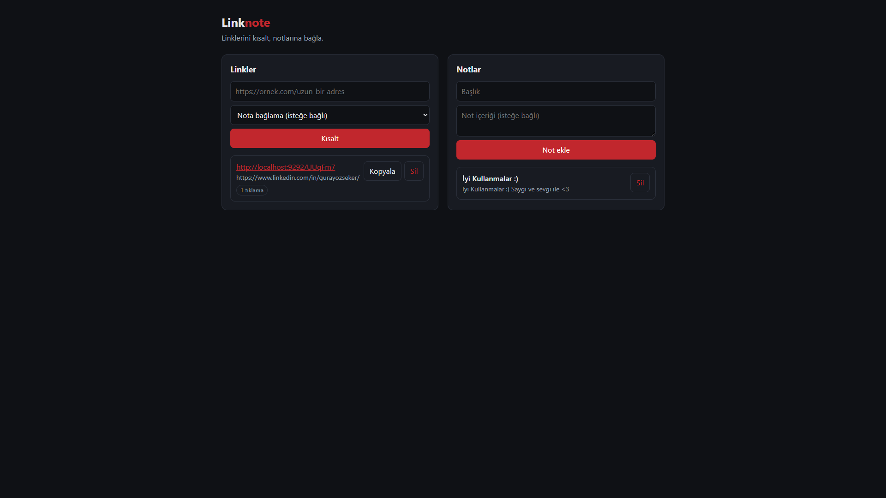

# Linknote

[](https://github.com/gurayozsekerr/linknote/actions/workflows/ci.yml)

Ruby ve Sinatra ile yazılmış, URL kısaltıcı ve not alma özelliklerini birleştiren küçük bir REST API. Basit bir web arayüzüyle birlikte gelir.



## Özellikler

- Uzun linkleri 6 haneli kısa kodlara çevirir, `/:code` adresinden yönlendirir
- Her yönlendirmede tıklama sayısını tutar
- Notlar için tam CRUD (oluştur, oku, güncelle, sil)
- Bir link bir nota bağlanabilir, nota bağlı linkler not çıktısında görünür
- Giriş doğrulama: geçersiz URL, boş başlık, olmayan nota bağlama gibi durumlar anlamlı hata mesajlarıyla reddedilir
- RSpec ile yazılmış otomatik testler ve GitHub Actions ile sürekli test

## Teknolojiler

Ruby 3.4, Sinatra, Sequel, SQLite, Puma, RSpec

## Kurulum

```bash
git clone https://github.com/gurayozsekerr/linknote.git
cd linknote
bundle install
bundle exec rackup
```

Uygulama `http://localhost:9292` adresinde açılır. Veritabanı ve tablolar ilk çalıştırmada otomatik oluşur.

## Testler

```bash
bundle exec rspec
```

Testler bellekte geçici bir SQLite veritabanı kullanır, gerçek verilere dokunmaz.

## API

| Metot | Adres | Açıklama |
|-------|-------|----------|
| GET | `/health` | Sunucu durumu |
| GET | `/notes` | Tüm notları listeler |
| GET | `/notes/:id` | Tek not getirir (bağlı linklerle) |
| POST | `/notes` | Not oluşturur (`title`, `body`) |
| PUT | `/notes/:id` | Notu günceller |
| DELETE | `/notes/:id` | Notu siler |
| GET | `/links` | Tüm linkleri listeler |
| GET | `/links/:code` | Link bilgisi ve tıklama sayısı |
| POST | `/links` | Kısa link oluşturur (`url`, isteğe bağlı `note_id`) |
| DELETE | `/links/:code` | Linki siler |
| GET | `/:code` | Orijinal adrese yönlendirir (302) |

### Hata kodları

| Kod | Anlamı |
|-----|--------|
| 400 | Geçersiz veya bozuk JSON |
| 404 | Kayıt bulunamadı |
| 422 | Doğrulama hatası (ör. geçersiz URL, başlıksız not) |

### Örnek

```bash
curl -X POST http://localhost:9292/links \
  -H "Content-Type: application/json" \
  -d '{"url":"https://github.com"}'
```

```json
{
  "id": 1,
  "code": "aB3xK9",
  "url": "https://github.com",
  "clicks": 0,
  "note_id": null,
  "short_url": "http://localhost:9292/aB3xK9"
}
```

## Proje yapısı

```
linknote/
├── app.rb              # Sinatra uygulaması ve rotalar
├── config.ru           # Rack giriş noktası
├── Gemfile
├── db/migrations/      # Veritabanı şeması
├── lib/
│   ├── database.rb     # Bağlantı ve otomatik migration
│   └── models/         # Note ve Link modelleri
├── public/index.html   # Web arayüzü
└── spec/               # RSpec testleri
```

## Tasarım kararları

- **302 yönlendirme:** 301 tarayıcılar tarafından önbelleğe alınır ve sonraki tıklamalar sunucuya gelmez, bu da tıklama sayacını bozar.
- **İzin verilen alanlar:** İstek gövdesinden sadece belirli alanlar okunur. Dışarıdan `id`, `code` veya `clicks` göndererek bu değerleri değiştirmek mümkün değildir.
- **Rastgele kod:** Kısa kodlar `SecureRandom` ile üretilir ve çakışma kontrol edilir.
- **XSS koruması:** Arayüz, kullanıcı metinlerini HTML olarak değil düz metin olarak sayfaya ekler.
- **Silme davranışı:** Bir not silinirse bağlı linkler silinmez, sadece nottan ayrılır.


## Geliştirici

**Güray Özşeker**

- LinkedIn: [linkedin.com/in/gurayozseker](https://www.linkedin.com/in/gurayozseker/)
- GitHub: [@gurayozsekerr](https://github.com/gurayozsekerr)
